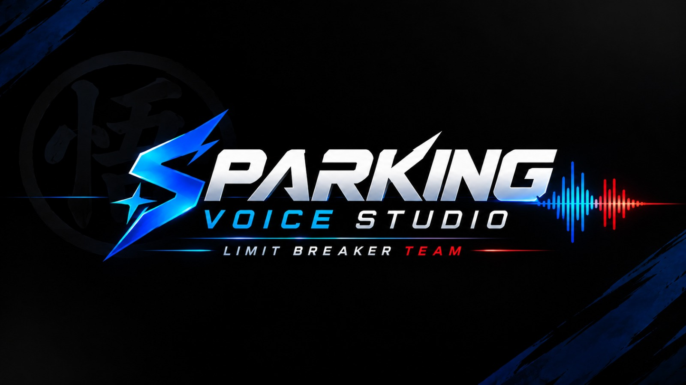

# Sparking Zero Voice Studio

Windows desktop editor for DRAGON BALL: Sparking! ZERO voice banks, with Custom and Replacer export workflows.

**[Download for Windows](https://github.com/vini2227/SPARKING-VOICE-STUDIO/releases/latest)** · [Release notes](https://github.com/vini2227/SPARKING-VOICE-STUDIO/releases) · [Watch on YouTube](https://www.youtube.com/watch?v=xJy1R0_-6Aw)

**User guides / Guias / Idiomas:**

[English](Readme/README_en.md) · [Português (Brasil)](Readme/README_pt.md) · [Español (España)](Readme/README_es.md) · [Español (Latinoamérica)](Readme/README_es-419.md) · [Français](Readme/README_fr.md) · [Italiano](Readme/README_it.md) · [日本語](Readme/README_ja.md) · [Deutsch](Readme/README_de.md) · [Русский](Readme/README_ru.md) · [Polski](Readme/README_pl.md) · [العربية](Readme/README_ar.md) · [简体中文](Readme/README_zh-Hans.md) · [繁體中文](Readme/README_zh-Hant.md) · [한국어](Readme/README_ko.md) · [ไทย](Readme/README_th.md) · [Bahasa Indonesia](Readme/README_id.md)

## Video

<a href="https://www.youtube.com/watch?v=xJy1R0_-6Aw"></a>

[▶ Watch the video on YouTube](https://www.youtube.com/watch?v=xJy1R0_-6Aw)

## Features

- English/Japanese bank browsing, localized character names and cue/function/interaction filtering.
- Multi-character mod packages with searchable character/folder groups, US/JP selection and voice counts. [Package workflow](docs/MULTI_CHARACTER_PACKAGES.md).
- Original/edited playback, media import, microphone recording, trimming and volume controls.
- Pitch-preserving speed changes, effects, clipping protection and optional local voice enhancement/isolation.
- Duplicate recording identification that survives derived edits when the input has been preserved.
- Project saves, session undo/redo, automatic recovery and portable project sharing.
- Custom and Replacer exports, original per-voice sample rates/channels and PCM16 encoder inputs.
- Interface, help and user guides in 16 languages.

## Performance

Audio batches can use multiple CPU workers. Select Automatic, Economy, Fast or Sequential in Settings. [Performance and fallback behavior](docs/PERFORMANCE.md).

## Install and update

End users should use a portable application ZIP, not the source ZIP. Close the app, merge a new portable ZIP into the **same installation folder**, and replace application files. Do not delete the old folder. Generated releases exclude personal settings and project folders. See [UPDATE.md](UPDATE.md) and [compatibility](docs/COMPATIBILITY.md).

[User guides in 16 languages](docs/USER_GUIDES.md).

## Run from source

Windows x64, Python 3.12 with Tkinter:

```powershell
py -3.12 -m venv .venv
.venv\Scripts\python.exe -m pip install -r requirements.txt
.venv\Scripts\python.exe -E -B src/app.py
```

Keep the checkout writable. The app uses built-in English/empty-path defaults if settings.json does not exist; settings.example.json is documentation, not an installer. Configure the game path in Settings.

External audio and Unreal tools must be installed separately for the features that require them. See [dependencies](docs/DEPENDENCIES.md). **Custom Engine and CustomProject are not included.** No game assets, personal audio, game key files, compiled tools, model weights or Python runtime are included in this source package.

## Development

- `src/`: application modules and C# Windows launcher.
- `Data/`: localization, public identification/reference catalogs and artwork; rights status is documented below.
- `Tools/`: source/release builders, release safety policy and localized guide generator.
- `tests/`: update preservation and project compatibility regression tests.
- `docs/`: architecture, release process and compatibility policy.

```powershell
.venv\Scripts\python.exe -m unittest discover -s tests -p "test_release_update.py" -v
.venv\Scripts\python.exe -m unittest discover -s tests -p "test_legacy_projects.py" -v
```

The second test requires Windows and the Python dependencies; it does not launch Unreal or the game. Full UI and real export validation require a configured local development installation.

## License

The original application source code is licensed under [GNU GPL version 3](LICENSE), SPDX identifier `GPL-3.0-only`. You may use, modify and redistribute it, including commercially, subject to the license. Distribution of covered binaries requires providing the corresponding source through a GPL-compliant method. Third-party components retain their own licenses. See [scope and third-party notices](docs/LICENSING.md).

Game assets and proprietary tools are not relicensed or included in this repository. Downloadable application packages are distributed separately through GitHub Releases.

See [contributing](CONTRIBUTING.md) and [changelog](CHANGELOG.md).

## Malwarebytes review

Malwarebytes staff whitelisted the launcher reported as MachineLearning/Anomalous.100%. [Official response](https://forums.malwarebytes.com/topic/341415-false-positive-sparking-zero-voice-studioexe-machinelearninganomalous/#findComment-1766947). This applies to executable SHA-256 `828788f5f3331327cadd073a726aa969215b4970b1ce061ace9dd671d0a7d9f8`, preserved in the 2026.11.01 reviewed ZIP. Update Malwarebytes before rescanning. It is not a guarantee about every antivirus or future build.
